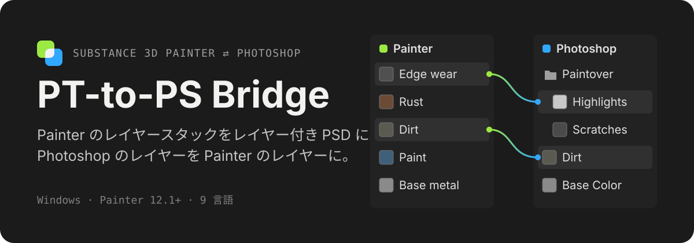
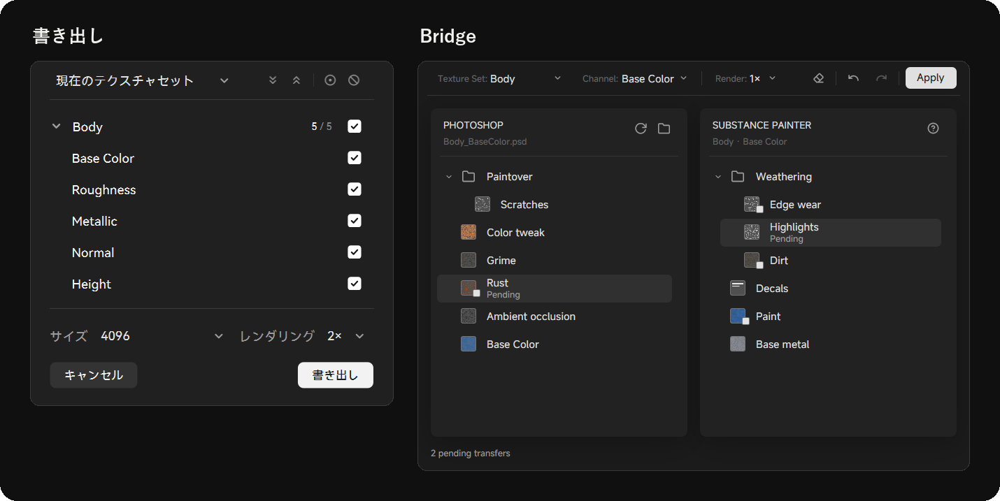
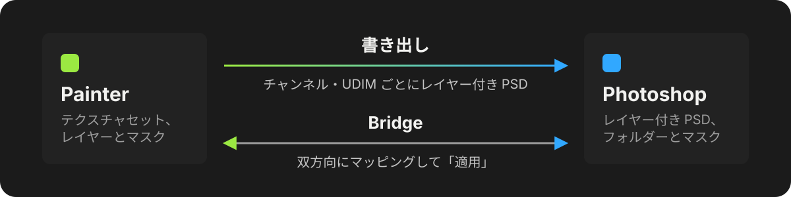

<p align="center">
  
</p>

<p align="center">
  <a href="README.md">English</a> · <a href="README.zh-CN.md">简体中文</a> · <b>日本語</b>
</p>

Photoshop で仕上げをするテクスチャアーティストのための Substance 3D Painter プラグインです。**書き出し**は Painter のレイヤースタックをレイヤー付き PSD にします。**Bridge** は両方のレイヤーツリーを並べたウィンドウを開き、Painter と Photoshop のあいだでレイヤーを移して、まとめて適用できます。

<p align="center">
  
</p>

## できること

**書き出し**

- チャンネルと UDIM タイルごとに PSD を 1 つ作り、Painter のレイヤー、フォルダー、マスク、描画モードを、Photoshop で再現できる範囲で Photoshop のレイヤーとして組み直します。
- PSD はプロジェクトのエクスポートプリセットに沿って名前が付き、Painter のエクスポートパスに保存されます。そこには PSD だけが残ります。
- PSD のサイズ、8 / 16 ビット、スーパーサンプリング、エッジスムージング、UV ワイヤーフレームレイヤーを設定できます。

**Bridge**

- 左に接続した PSD のレイヤー、右に現在のテクスチャセットのレイヤーを表示します。レイヤーを反対側へドラッグし、置きたい位置にドロップします。
- Photoshop のレイヤーは Painter のレイヤーとして入り、Painter のレイヤーは Photoshop の PSD に挿入されます。**適用**を押すまで、どちらにも変更は入りません。
- PSD はプラグインが直接読むので、ドキュメントを接続しても Photoshop は開きません。
- テクスチャセットごとに PSD を覚えます。書き出しで作った PSD も含まれ、テクスチャセットの名前を変えても失われません。

## しくみ

<p align="center">
  
</p>

Painter が自身のテクスチャ書き出しで各レイヤーとマスクをレンダリングし、Photoshop がプラグインの実行するスクリプトでそれらを組み直します。Photoshop にインストールするものはありません。Bridge は独立したデスクトップウィンドウで、ファイルを通じて Painter とやり取りし、適用を押したときだけ動きます。

## インストール

1. [最新リリース](https://github.com/Rizumu85/rizum-pt-to-ps-bridge/releases/latest) から `rizum-pt-to-ps-bridge-<バージョン>.zip` をダウンロードします。
2. Painter のプラグインフォルダーに展開し、古い `rizum-pt-to-ps-bridge` フォルダーを置き換えます（先に Bridge ウィンドウを閉じてください）。

   ```text
   Documents/Adobe/Adobe Substance 3D Painter/python/plugins/
   ```

3. Painter を再起動します。プラグインが有効になっていなければ、**Python** メニューから有効にします。
4. **PT Bridge** パネルを開き、**設定**で `Photoshop.exe` のパスを指定します。

zip にはビルド済みの Bridge ウィンドウが入っているので、ほかに必要なものはありません。

## 使い方

- **書き出し**：**書き出し**をクリックし、**現在のテクスチャセット**か**すべてのテクスチャセット**を選び、チャンネルにチェックを入れて**書き出し**を押します。Photoshop が開いて PSD を作り、進行状況は Painter と Photoshop の両方に表示されます。
- **Bridge**：**Bridge** をクリックし、PSD を接続します（書き出しで作った PSD は自動でリンクされます）。両側のあいだでレイヤーをドラッグし、**適用**を押します。もう一度 **Bridge** をクリックすると、ウィンドウが前面に出て両側が更新されます。

## 動作環境

- Windows
- Substance 3D Painter 12.1 以降
- デスクトップ版 Photoshop（開発には Photoshop 26 を使用）

プラグインは Painter の言語に合わせて表示されます：English、简体中文、日本語、한국어、Deutsch、Français、Español、Italiano、Português。

## 持ち込めないもの

- 書き出したレイヤーはピクセルレイヤーです。Painter の塗りつぶし、ジェネレーター、フィルターはレンダリング結果として入ります。
- Photoshop からは、レイヤースタイルは外れ、クリッピングされたレイヤーはベースに統合され、べた塗りは色のまま残ります。調整レイヤーとグラデーション・パターンの塗りつぶしはマッピングできません。

## 開発

リポジトリがそのままプラグインフォルダーです。

- `sp_plugin/rizum_sp_to_ps/`：Painter プラグインと、それが実行する Photoshop スクリプト（`*.jsx`）。ルートの `__init__.py` / `rizum_pt_to_ps_bridge.py` がここに処理を渡します。
- `desktop/`：Bridge ウィンドウ（ネイティブの GPUiX アプリ）。[Bun](https://bun.sh) でビルドします。

  ```text
  cd desktop
  bun install
  bun run build
  ```

  開発時の実行方法は [`desktop/README.md`](desktop/README.md) を参照してください。

Painter の Python テストとデスクトップのチェックを実行するには：

```text
pwsh tools/run-checks.ps1
```
