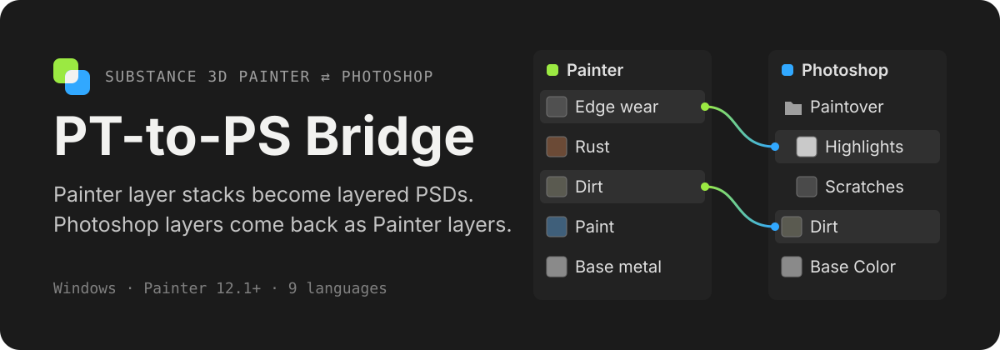
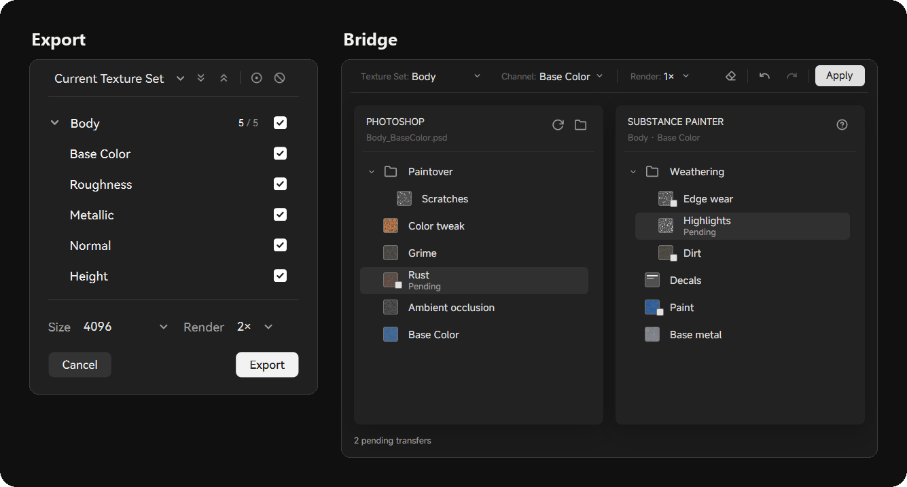
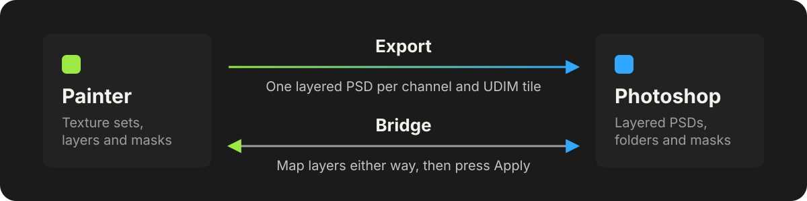

<p align="center">
  
</p>

<p align="center">
  <b>English</b> · <a href="README.zh-CN.md">简体中文</a> · <a href="README.ja.md">日本語</a>
</p>

A Substance 3D Painter plugin for texture artists who finish their work in
Photoshop. **Export** turns Painter layer stacks into layered PSDs. **Bridge**
opens a window with both layer trees side by side, so you can move layers
between Painter and Photoshop and apply them in one go.

<p align="center">
  
</p>

## What it does

**Export**

- Builds one PSD per channel and UDIM tile, with Painter's layers, folders,
  masks and blend modes rebuilt as Photoshop layers, as far as Photoshop can
  match them.
- Names the PSDs with the project's export preset and saves them into
  Painter's export path. Only the PSDs are left there.
- Options for PSD size, 8 or 16 bit, supersampled rendering, edge smoothing
  and a UV wireframe layer.

**Bridge**

- Shows the current texture set's layers and the connected PSD's layers side
  by side. Drag a layer across and drop it where it should land.
- Photoshop layers arrive in Painter as layers, and Painter layers are inserted
  into the PSD in Photoshop. Nothing changes in either app until you press
  **Apply**.
- Reads the PSD itself, so connecting a document does not open Photoshop.
- Remembers each texture set's PSDs, including the ones Export built, even
  after the texture set is renamed.

## How it works

<p align="center">
  
</p>

Painter renders each layer and mask with its own texture export. Photoshop
rebuilds them through scripts that the plugin runs, so nothing is installed
in Photoshop. Bridge is a separate desktop window; it talks to Painter through
files and only acts when you press Apply.

## Install

1. Download `rizum-pt-to-ps-bridge-<version>.zip` from the
   [latest release](https://github.com/Rizumu85/rizum-pt-to-ps-bridge/releases/latest).
2. Unzip it into Painter's plugin folder, replacing any older
   `rizum-pt-to-ps-bridge` folder (close the Bridge window first):

   ```text
   Documents/Adobe/Adobe Substance 3D Painter/python/plugins/
   ```

3. Restart Painter. If the plugin is not on, enable it from the **Python**
   menu.
4. Open the **PT Bridge** dock, click **Settings** and set the path to
   `Photoshop.exe`.

The zip includes the prebuilt Bridge window, so nothing else is needed.

## Use

- **Export:** click **Export**, choose **Current Texture Set** or **All
  Texture Sets**, tick the channels and press **Export**. Photoshop opens and
  builds the PSDs; the progress shows in Painter and in Photoshop.
- **Bridge:** click **Bridge**, connect a PSD (ones built by Export are
  already linked), drag layers between the two sides and press **Apply**.
  Clicking **Bridge** again brings the window back and refreshes both sides.

## Requirements

- Windows
- Substance 3D Painter 12.1 or later
- Photoshop for desktop (developed with Photoshop 26)

The plugin follows Painter's language: English, 简体中文, 日本語, 한국어,
Deutsch, Français, Español, Italiano and Português.

## What does not come across

- Exported layers are pixel layers: Painter's fills, generators and filters
  arrive as their rendered result.
- From Photoshop, layer styles are dropped, clipped layers are merged into
  their base, and solid colour fills stay colours. Adjustment layers and
  gradient or pattern fills cannot be mapped.

## Development

The repository is the plugin folder itself:

- `sp_plugin/rizum_sp_to_ps/`: the Painter plugin and the Photoshop scripts
  (`*.jsx`) it runs. The root `__init__.py` / `rizum_pt_to_ps_bridge.py` shim
  delegates to it.
- `desktop/`: the Bridge window, a native GPUiX app. Build it with
  [Bun](https://bun.sh):

  ```text
  cd desktop
  bun install
  bun run build
  ```

  See [`desktop/README.md`](desktop/README.md) for development runs.

Run the Painter Python tests and the desktop checks with:

```text
pwsh tools/run-checks.ps1
```

## License

[MIT](LICENSE). The fonts and libraries bundled with the Bridge window keep
their own licenses, listed in `desktop/dist/THIRD-PARTY-NOTICES.txt` in the
release zip.
