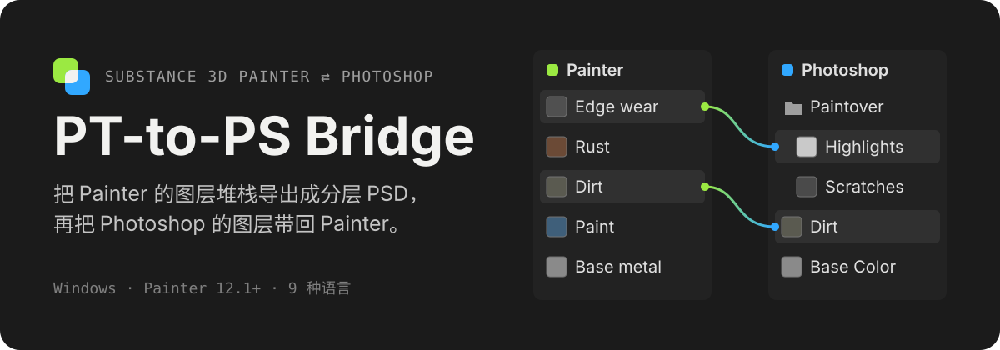
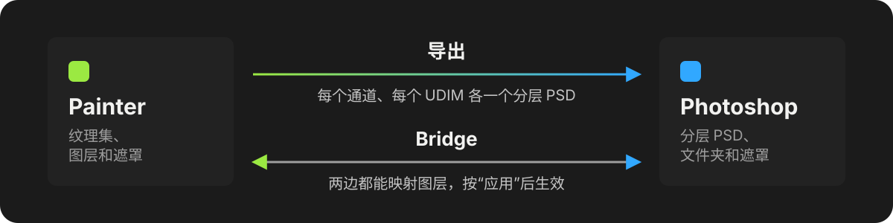

<p align="center">
  
</p>

<p align="center">
  <a href="README.md">English</a> · <b>简体中文</b> · <a href="README.ja.md">日本語</a>
</p>

这是一个 Substance 3D Painter 插件，给最后要在 Photoshop 里收尾的贴图师用。**导出**把 Painter 的图层堆栈变成分层 PSD。**Bridge** 打开一个窗口，把两边的图层树并排放在一起，你可以在 Painter 和 Photoshop 之间挪动图层，一次应用。

## 功能

**导出**

- 每个通道、每个 UDIM 各生成一个 PSD，Painter 的图层、文件夹、遮罩和混合模式都会尽量还原成 Photoshop 图层。
- PSD 按项目的导出预设命名，保存到 Painter 的导出路径，那里只留下 PSD。
- 可以设置 PSD 大小、8 位或 16 位、超采样渲染、边缘平滑，以及 UV 线框图层。

**Bridge**

- 左边是当前纹理集的图层，右边是已连接 PSD 的图层。把图层拖到另一边，放在你想要的位置。
- Photoshop 的图层会作为图层进入 Painter，Painter 的图层会插入 Photoshop 里的 PSD。按下**应用**之前，两边都不会有任何改动。
- 插件自己读取 PSD，所以连接文档时不会打开 Photoshop。
- 每个纹理集会记住自己的 PSD，包括导出生成的那些；纹理集改名后也不会丢。

## 工作方式

<p align="center">
  
</p>

Painter 用自己的纹理导出渲染每个图层和遮罩，Photoshop 再通过插件运行的脚本把它们重建出来，所以 Photoshop 里什么都不用装。Bridge 是一个独立的桌面窗口，通过文件和 Painter 通信，只有按下应用时才会动手。

## 安装

1. 从[最新版本](https://github.com/Rizumu85/rizum-pt-to-ps-bridge/releases/latest) 下载 `rizum-pt-to-ps-bridge-<版本>.zip`。
2. 解压到 Painter 的插件目录，替换旧的 `rizum-pt-to-ps-bridge` 文件夹（先关掉 Bridge 窗口）：

   ```text
   Documents/Adobe/Adobe Substance 3D Painter/python/plugins/
   ```

3. 重启 Painter。如果插件没有启用，在 **Python** 菜单里打开它。
4. 打开 **PT Bridge** 面板，点**设置**，填好 `Photoshop.exe` 的路径。

压缩包里已经带了编译好的 Bridge 窗口，不需要再装别的。

## 使用

- **导出**：点**导出**，选择**当前纹理集**或**所有纹理集**，勾选通道后按**导出**。Photoshop 会打开并生成 PSD，Painter 和 Photoshop 里都会显示进度。
- **Bridge**：点 **Bridge**，连接一个 PSD（导出生成的会自动关联），在两边之间拖动图层，然后按**应用**。再点一次 **Bridge** 会把窗口调到前面，并刷新两边。

## 要求

- Windows
- Substance 3D Painter 12.1 或更高版本
- 桌面版 Photoshop（开发时使用 Photoshop 26）

插件跟随 Painter 的语言：English、简体中文、日本語、한국어、Deutsch、Français、Español、Italiano 和 Português。

## 带不过去的内容

- 导出的图层都是像素图层：Painter 的填充、生成器和滤镜会以渲染结果的形式出现。
- 从 Photoshop 过来时，图层样式会丢掉，剪贴图层会合并到底层，纯色填充保持为颜色。调整图层以及渐变、图案填充不能映射。

## 开发

仓库本身就是插件目录：

- `sp_plugin/rizum_sp_to_ps/`：Painter 插件，以及它运行的 Photoshop 脚本（`*.jsx`）。根目录的 `__init__.py` / `rizum_pt_to_ps_bridge.py` 负责转接到这里。
- `desktop/`：Bridge 窗口，一个原生 GPUiX 应用。用 [Bun](https://bun.sh) 构建：

  ```text
  cd desktop
  bun install
  bun run build
  ```

  开发时的运行方法见 [`desktop/README.md`](desktop/README.md)。

运行 Painter 的 Python 测试和桌面端检查：

```text
pwsh tools/run-checks.ps1
```
